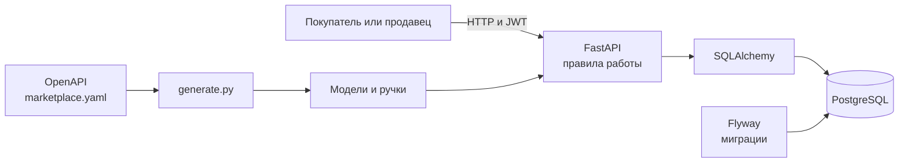

# ДЗ №2. API маркетплейса

В первой ДЗ я спроектировал архитектуру маркетплейса. Здесь я сделал отдельный API товаров и заказов на FastAPI и PostgreSQL. Код первой работы для запуска не нужен. Описание API лежит в `src/main/resources/openapi/marketplace.yaml`.

## Запуск

Нужен Docker Compose. Команды запуска из папки `homework2`.

```bash
docker compose up --build -d
docker compose logs -f api
```

API работает по адресу `http://localhost:8081`. Swagger UI открыт по адресу `http://localhost:8081/docs`, исходный контракт по адресу `http://localhost:8081/openapi.yaml`. PostgreSQL доступен на порту `5433`.

Быстрая проверка API.

```bash
./scripts/demo.sh
```

Скрипт регистрирует продавца и покупателя, создаёт товар и заказ, отменяет заказ, проверяет остаток и выполняет `SELECT` из таблиц. Данные в скрипте каждый раз новые.

Остановить контейнеры.

```bash
docker compose down
```

Для полного сброса учебной БД можно выполнить `docker compose down -v`.

## Схема реализации второй ДЗ

В первой ДЗ C4-диаграмма показывает план системы с отдельными сервисами. Ниже показано то, что действительно запускается во второй ДЗ. Здесь одно приложение FastAPI и одна база PostgreSQL. Это позволяет менять остатки и заказ в одной транзакции.



- `marketplace.yaml` содержит схемы запросов и ответов, ограничения, роли и возможные ошибки.
- `scripts/generate.py` при сборке создаёт `app/generated/models.py` с моделями запросов и ответов и `app/generated/routes.py` с ручками API. Ручки вызывают `service.execute`. Сгенерированные файлы не хранятся в Git.
- `app/service.py` содержит правила доступа и бизнес-логику.
- `app/db.py` содержит классы для работы с таблицами. Flyway создаёт таблицы миграцией `V1__create_tables.sql`, а `V2__native_enums.sql` задаёт типы статусов и ролей.
- `app/main.py` запускает приложение, формирует ошибки и пишет JSON-лог каждого запроса.

После установки зависимостей генерацию можно запустить без Docker.

```bash
python3 -m pip install -r requirements.txt
python3 scripts/generate.py
```

## Основные правила

Покупатель может оформлять и менять свои заказы, продавец управляет только своими товарами. Администратор создаётся при старте из `ADMIN_EMAIL` и `ADMIN_PASSWORD` (по умолчанию `admin@example.com` / `admin12345` для локальной демонстрации). Регистрировать администратора через API нельзя. Access token действует 20 минут, refresh token действует 14 дней. Секрет JWT задаётся переменной `JWT_SECRET`.

При создании заказа сначала проверяются лимит частоты, активный заказ, товары и остатки. Затем в одной транзакции уменьшается `stock` и сохраняется заказ с ценами позиций. При обновлении старые остатки возвращаются, новые резервируются, сумма пересчитывается. При отмене остатки и использование промокода возвращаются. Для параллельных запросов используются блокировки строк в БД.

Если процентная скидка больше 70%, она не применяется и заказ остаётся по полной цене. Скидка в остальных случаях округляется до копеек. При обновлении заказа, если сумма стала меньше минимальной для промокода, промокод снимается.

`ORDER_LIMIT_MINUTES` по умолчанию равен `1`. Для быстрой проверки нескольких обновлений подряд можно запустить с `ORDER_LIMIT_MINUTES=0 docker compose up --build -d`.

## Небольшие примеры

```bash
curl -X POST http://localhost:8081/auth/register \
  -H 'Content-Type: application/json' \
  -d '{"email":"buyer@example.com","password":"password123","role":"USER"}'

curl -X POST http://localhost:8081/auth/login \
  -H 'Content-Type: application/json' \
  -d '{"email":"buyer@example.com","password":"password123"}'
```

Из ответа входа взять `access_token` и передать его как `Authorization: Bearer <token>` во все остальные запросы. Остальные запросы удобно выполнять в Swagger UI.

Проверка таблиц вручную.

```bash
docker compose exec db psql -U marketplace -d marketplace -c 'SELECT id, name, stock, status FROM products;'
docker compose exec db psql -U marketplace -d marketplace -c 'SELECT id, user_id, status, total_amount FROM orders;'
docker compose exec db psql -U marketplace -d marketplace -c 'SELECT order_id, product_id, quantity, price_at_order FROM order_items;'
docker compose exec db psql -U marketplace -d marketplace -c 'SELECT code, current_uses FROM promo_codes;'
```
